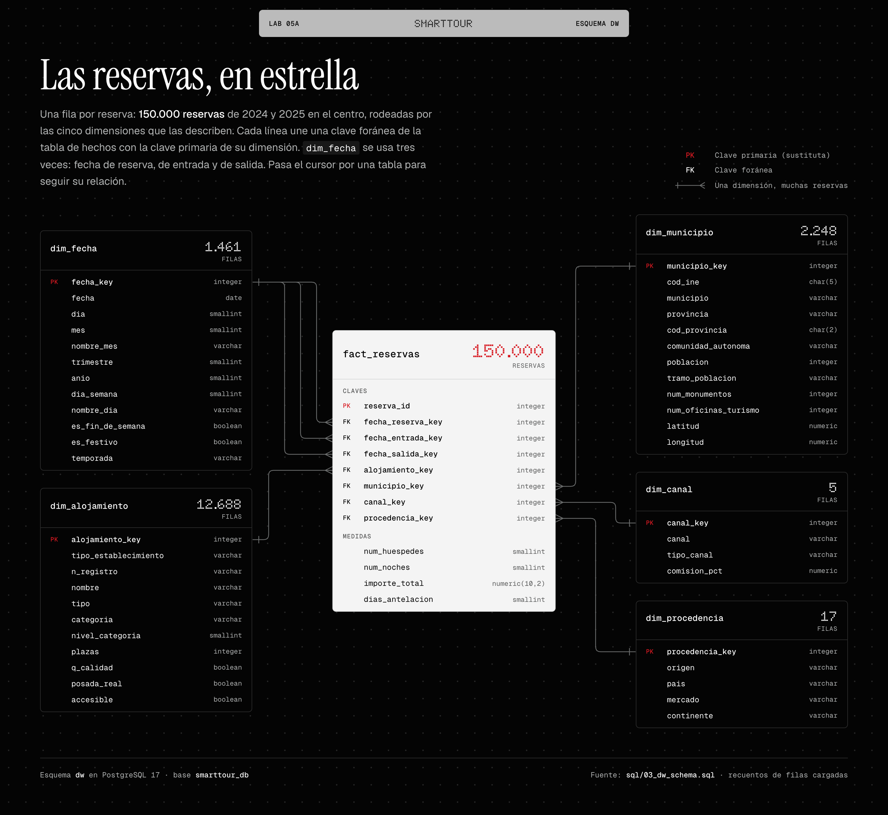
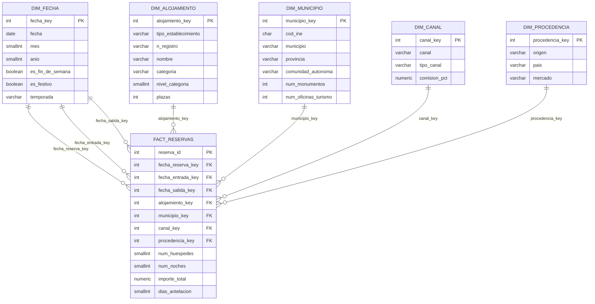

# Lab 05a · Diseñando el primer Data Warehouse de SmartTour

Data Warehouse de **reservas turísticas** de Castilla y León, diseñado como esquema en estrella.

| Pieza | Archivo |
|---|---|
| Datos fuente limpios | `datasets/clean/*.csv` (`scripts/clean_datasets.py`) |
| Generación de dimensiones y hechos ficticios | `scripts/generate_dw.py` → `datasets/dw/*.csv` |
| DDL del esquema en estrella | `sql/03_dw_schema.sql` |
| Carga | `sql/04_dw_load.sql` |
| Consultas analíticas | `sql/05_dw_queries.sql` |
| Actividades 1, 2, 3, 5 y 6 | `notebooks/02_Lab05a_Data_Warehouse.ipynb` |
| Diagrama (actividad 4) | `docs/lab05a/diagrama.html` · `smarttour_dw.png` · `smarttour_dw.dbml` |

Para reproducirlo, con los contenedores levantados y desde la raíz del repositorio:

```bash
python scripts/generate_dw.py
docker exec smarttour-postgres psql -U smarttour -d smarttour_db -f /smarttour/sql/03_dw_schema.sql
docker exec smarttour-postgres psql -U smarttour -d smarttour_db -f /smarttour/sql/04_dw_load.sql
docker exec smarttour-postgres psql -U smarttour -d smarttour_db -f /smarttour/sql/05_dw_queries.sql
```

---

## Actividades 1, 2, 3, 5 y 6

Están resueltas en el cuaderno [`notebooks/02_Lab05a_Data_Warehouse.ipynb`](../../notebooks/02_Lab05a_Data_Warehouse.ipynb). Cada respuesta va acompañada del código que la comprueba con los datos:

| Actividad | Qué hay en el cuaderno |
|---|---|
| 1. Fuentes de datos | Tamaño y campos de cada CSV, comprobación de claves primarias (por qué `n_registro` no sirve), relaciones por `cod_ine` y hallazgos de calidad |
| 2. Hechos y dimensiones | Hecho elegido (reservas), grano, justificación de cada dimensión y por qué monumentos y oficinas son atributos |
| 3. Esquema en estrella | Tabla de hechos, dimensiones, integridad de claves y por qué no se guarda el precio por persona y noche |
| 5. Justificación | Respuestas a las cinco preguntas del enunciado |
| 6. Consultas analíticas | Siete preguntas de negocio resueltas con un *star join*, con tablas y gráficas. Los resultados coinciden con `sql/05_dw_queries.sql` |

Para abrirlo, entra en Jupyter (`docker compose up -d jupyter` y luego http://127.0.0.1:8888) y ve a `smarttour/notebooks/`.

## Actividad 4. Diagrama



El diagrama está hecho en HTML, CSS y JS, sin dependencias, con el mismo estilo visual que las presentaciones de los labs: [`diagrama.html`](diagrama.html). Ábrelo en el navegador para ver la versión interactiva: al pasar el cursor por una tabla se resalta su relación con la tabla de hechos. Cada línea va desde la clave primaria de la dimensión hasta su clave foránea en `fact_reservas`, con la notación «una dimensión, muchas reservas». `smarttour_dw.png` es una captura de esa página a 1440 px de ancho y doble resolución.

También se incluye `smarttour_dw.dbml`, por si se quiere abrir el modelo en [dbdiagram.io](https://dbdiagram.io/d).

<details>
<summary>Versión Mermaid (se muestra directamente en GitHub)</summary>



</details>

Todas las relaciones son **1:N**: un miembro de dimensión (un día, un alojamiento…) aparece en muchas reservas, y cada reserva apunta a exactamente un miembro de cada dimensión.
