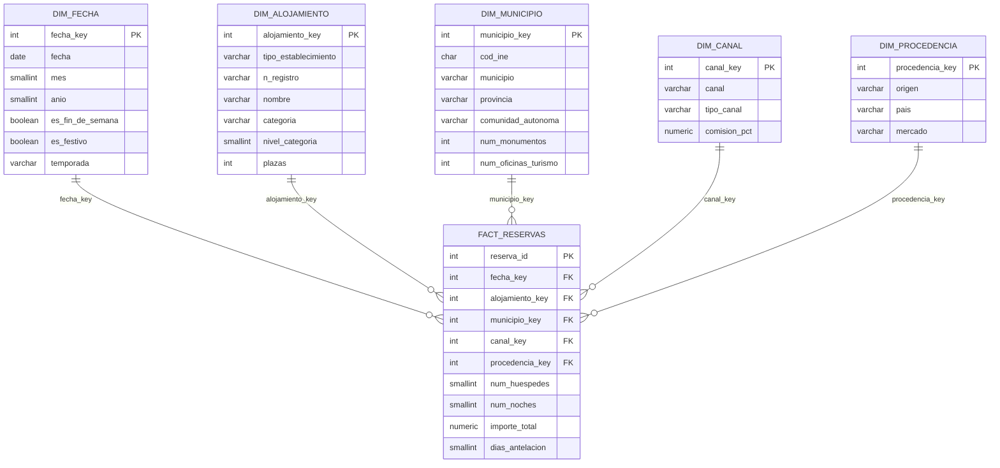

# Lab 05a · Diseñando el primer Data Warehouse de SmartTour

Data Warehouse de **reservas turísticas** de Castilla y León, diseñado como esquema en estrella.

| Pieza | Archivo |
|---|---|
| Datos fuente limpios | `datasets/clean/*.csv` (`scripts/clean_datasets.py`) |
| Generación de dimensiones y hechos ficticios | `scripts/generate_dw.py` → `datasets/dw/*.csv` |
| DDL del esquema en estrella | `sql/03_dw_schema.sql` |
| Carga | `sql/04_dw_load.sql` |
| Consultas analíticas | `sql/05_dw_queries.sql` |
| Diagrama (dbdiagram.io) | `docs/lab05a/smarttour_dw.dbml` |

Para reproducirlo, con los contenedores levantados y desde la raíz del repositorio:

```bash
python scripts/generate_dw.py
docker exec smarttour-postgres psql -U smarttour -d smarttour_db -f /smarttour/sql/03_dw_schema.sql
docker exec smarttour-postgres psql -U smarttour -d smarttour_db -f /smarttour/sql/04_dw_load.sql
docker exec smarttour-postgres psql -U smarttour -d smarttour_db -f /smarttour/sql/05_dw_queries.sql
```

---

## Actividad 1. Análisis de las fuentes de datos

| Archivo | Filas | Información principal | Qué representa un registro | Clave primaria | Relaciones |
|---|---|---|---|---|---|
| `municipios.csv` | 2.248 | Municipio, provincia, población, coordenadas, mancomunidades | Un municipio de CyL | `cod_ine` | Es la tabla central: todas las demás apuntan a ella |
| `hoteles.csv` | 12.688 | Alojamientos del Registro de Turismo: tipo, categoría, plazas, contacto, distintivos (Q de Calidad, Posada Real, accesible) | Un establecimiento de alojamiento | `(tipo_establecimiento, n_registro)` | N:1 con municipios por `cod_ine` |
| `monumentos.csv` | 1.374 | Nombre, tipo, clasificación, periodo histórico, descripción, coordenadas | Un monumento o bien patrimonial | `id_monumento` | N:1 con municipios por `cod_ine` |
| `oficinas_turismo.csv` | 262 | Nombre, ámbito (municipal, provincial…), localidad | Una oficina o punto de información turística | **No tiene**: se necesita una clave sustituta | N:1 con municipios por `cod_ine` |

Hallazgos relevantes para el diseño:

- **`n_registro` no es único por sí solo.** Tiene 4.941 valores repetidos, porque la Junta numera el registro por separado para cada tipo de establecimiento. Por ejemplo, `05/000802` es a la vez una vivienda turística en Arévalo y una casa rural en La Aldehuela. La pareja `(tipo_establecimiento, n_registro)` no tiene ningún duplicado, así que esa es la clave natural.
- `oficinas_turismo.csv` no trae identificador, y el nombre no es fiable como clave.
- 53 alojamientos no tienen plazas informadas. Se mantienen en la dimensión, pero no reciben reservas simuladas.
- La `categoria` mezcla escalas distintas: estrellas, llaves (apartamentos) y conchas (albergues del Camino). Se deriva un `nivel_categoria` del 1 al 5 que permite compararlas.
- `comarca` solo está informada en 38 de los 2.248 municipios, por lo que no se usa como atributo.

## Actividad 2. Hechos y dimensiones

**Hecho elegido: las reservas.** Las cuatro fuentes son *catálogos*: describen cosas que existen (municipios, alojamientos, monumentos, oficinas). Ninguna registra *eventos* que ocurran en el tiempo y se puedan medir. Una reserva sí lo es: ocurre en una fecha, en un alojamiento concreto y tiene cantidades numéricas que sumar. Como el enunciado permite, las reservas se generan de forma ficticia con `scripts/generate_dw.py`. Usa una semilla fija y reglas realistas: estacionalidad, más reservas en fines de semana y festivos, huéspedes ≤ plazas y precio según tipo y categoría.

**Grano:** una fila por reserva. Es el nivel más detallado posible, así que cualquier agregado (por día, por mes, por provincia…) puede calcularse después. Al revés no se puede.

| Dimensión | Fuente | Justificación |
|---|---|---|
| `dim_fecha` | Generada (calendario 2024–2025) | Todo análisis de reservas es temporal: meses, temporadas, fines de semana, festivos. Precalcular estos atributos evita lógica de fechas en cada consulta. |
| `dim_alojamiento` | `hoteles.csv` | Es *dónde* se reserva. Permite analizar por tipo, categoría, tamaño o distintivos de calidad. |
| `dim_municipio` | `municipios.csv` + recuentos de `monumentos.csv` y `oficinas_turismo.csv` | Es el eje geográfico (municipio → provincia → comunidad). Monumentos y oficinas se incorporan como **atributos** (nº de monumentos y nº de oficinas), no como dimensiones. |
| `dim_canal` | Catálogo ficticio | *Cómo* se reserva: directo frente a intermediado, y comisiones. |
| `dim_procedencia` | Catálogo ficticio | *Quién* reserva: mercado nacional o internacional, y región o país de origen. |

**¿Por qué monumentos y oficinas no son dimensiones de esta tabla?** Una dimensión tiene sentido solo si cada hecho se asocia a **un** miembro de ella. Una reserva de hotel no ocurre "en un monumento" ni "en una oficina de turismo", así que la clave foránea no tendría significado. Esos datos sí describen el atractivo turístico del municipio, y por eso se resumen como atributos de `dim_municipio`. Si más adelante se modela un hecho de **visitas** (`Fact_Visitas`), `dim_monumento` sería una dimensión natural de ese otro hecho. Además, `dim_municipio` y `dim_fecha` se reutilizarían tal cual: serían *dimensiones conformadas*.

## Actividad 3. Esquema en estrella

### Tabla de hechos: `dw.fact_reservas`

| Columna | Tipo | Papel |
|---|---|---|
| `reserva_id` | int | **PK** |
| `fecha_key` | int | **FK** → `dim_fecha` (fecha de entrada) |
| `alojamiento_key` | int | **FK** → `dim_alojamiento` |
| `municipio_key` | int | **FK** → `dim_municipio` |
| `canal_key` | int | **FK** → `dim_canal` |
| `procedencia_key` | int | **FK** → `dim_procedencia` |
| `num_huespedes` | smallint | Medida aditiva |
| `num_noches` | smallint | Medida aditiva |
| `importe_total` | numeric(10,2) | Medida aditiva (€) |
| `dias_antelacion` | smallint | Medida **no aditiva**: se promedia, no se suma |

El nº de reservas se obtiene con `COUNT(*)`. El precio medio por persona y noche se calcula como `SUM(importe_total) / SUM(num_huespedes * num_noches)`. No se almacena porque es un cociente: si se guardara por fila, al sumarlo daría un resultado incorrecto.

`municipio_key` está en la tabla de hechos aunque podría deducirse del alojamiento. Así cada dimensión cuelga directamente del hecho (estrella pura, sin copo de nieve) y los análisis geográficos no necesitan pasar por `dim_alojamiento`.

### Dimensiones

| Dimensión | Filas | Atributos |
|---|---|---|
| `dim_fecha` | 731 | `fecha_key` (AAAAMMDD), fecha, día, mes, nombre_mes, trimestre, año, día_semana, nombre_día, es_fin_de_semana, es_festivo, temporada |
| `dim_municipio` | 2.248 | `municipio_key`, cod_ine, municipio, provincia, cod_provincia, comunidad_autonoma, población, tramo_poblacion, num_monumentos, num_oficinas_turismo, latitud, longitud |
| `dim_alojamiento` | 12.688 | `alojamiento_key`, tipo_establecimiento, n_registro, nombre, tipo, categoria, nivel_categoria, plazas, q_calidad, posada_real, accesible |
| `dim_canal` | 5 | `canal_key`, canal, tipo_canal, comision_pct |
| `dim_procedencia` | 17 | `procedencia_key`, origen, país, mercado, continente |

Todas usan **claves sustitutas** (enteros autogenerados) en lugar de las claves naturales. Hay dos motivos: la clave natural de alojamiento es compuesta, y las oficinas ni siquiera tienen una. Las claves naturales se conservan como atributos únicos (`cod_ine`, `tipo_establecimiento + n_registro`).

## Actividad 4. Diagrama


El diagrama está hecho en HTML, CSS y JS, sin dependencias, con el mismo estilo visual que las presentaciones de los labs: [`diagrama.html`](diagrama.html). Ábrelo en el navegador para ver la versión interactiva: al pasar el cursor por una tabla se resalta su relación con la tabla de hechos. Cada línea va desde la clave primaria de la dimensión hasta su clave foránea en `fact_reservas`, con la notación «una dimensión, muchas reservas». `smarttour_dw.png` es una captura de esa página a 1440 px de ancho y doble resolución.

También se incluye `smarttour_dw.dbml`, por si se quiere abrir el modelo en [dbdiagram.io](https://dbdiagram.io/d).

<details>
<summary>Versión Mermaid (se muestra directamente en GitHub)</summary>



</details>

Todas las relaciones son **1:N**: un miembro de dimensión (un día, un alojamiento…) aparece en muchas reservas, y cada reserva apunta a exactamente un miembro de cada dimensión.

## Actividad 5. Justificación del diseño

**1. ¿Por qué `fact_reservas` es una tabla de hechos?**
Registra eventos de negocio medibles: cada fila es una reserva que ocurrió en un momento concreto. Es la tabla que más crece (150.000 filas frente a 5–12.688 de cada dimensión). Contiene casi solo claves foráneas y números, y existe para ser agregada con `SUM`, `COUNT` y `AVG`.

**2. ¿Qué medidas contiene?**
`num_huespedes`, `num_noches` e `importe_total`, que son aditivas en todas las dimensiones, y `dias_antelacion`, que no es aditiva y se analiza con promedios. A partir de ellas se derivan el nº de reservas (`COUNT(*)`), las pernoctaciones (`huéspedes × noches`), el precio medio por persona y noche, la estancia media y las comisiones pagadas.

**3. ¿Por qué las demás tablas son dimensiones?**
Aportan el **contexto** de cada reserva: cuándo (fecha), dónde (alojamiento, municipio), cómo (canal) y quién (procedencia). Sus atributos son descriptivos y se usan para filtrar y agrupar, no para sumar. Además cambian poco y tienen muchas menos filas que el hecho.

**4. Ventajas del esquema en estrella**
- **Consultas simples:** todas siguen el patrón *hechos JOIN dimensiones GROUP BY atributo*, con un solo nivel de joins.
- **Rendimiento:** pocos joins, dimensiones pequeñas y claves foráneas indexadas. Los motores OLAP lo optimizan específicamente (*star join*).
- **Comprensible para negocio:** las preguntas se traducen casi literalmente a SQL o a una herramienta de BI.
- **Extensible:** se pueden añadir dimensiones o nuevos hechos (visitas, ingresos) que reutilicen `dim_fecha` y `dim_municipio`.
- La desnormalización de las dimensiones (por ejemplo, la provincia repetida en cada municipio) es redundancia **intencionada**: a cambio de algo de espacio se evitan joins.

**5. ¿Qué consultas podrán realizarse?**
Análisis de reservas e ingresos cruzando cualquier combinación de tiempo, geografía, tipo de alojamiento, canal y origen del cliente. Por ejemplo, operaciones *roll-up* (de municipio a provincia, de día a mes), *drill-down* y *slice/dice*, como "reservas de turismo rural en Segovia en temporada alta por mercado internacional". Se concretan en la actividad 6.

## Actividad 6. Consultas analíticas

Todas están implementadas y probadas en `sql/05_dw_queries.sql`, contra PostgreSQL 17 con los datos generados.

| # | Pregunta de negocio | Dimensiones y medidas |
|---|---|---|
| 1 | ¿Qué provincias generan más reservas e ingresos? | municipio (provincia) · `COUNT`, `SUM(importe_total)` |
| 2 | ¿Cómo evolucionan las reservas por mes y cuánto crecen de 2024 a 2025? | fecha (mes, año) · `COUNT` |
| 3 | ¿Qué tipo de alojamiento factura más y cuál es su precio medio por persona y noche? | alojamiento · `SUM(importe)`, `SUM(huéspedes × noches)` |
| 4 | ¿Qué canales se usan más y cuánto se paga en comisiones a intermediarios? | canal · `COUNT`, `SUM(importe × comisión)` |
| 5 | ¿De dónde vienen los clientes y con cuánta antelación reservan? | procedencia · `COUNT`, `AVG(dias_antelacion)` |
| 6 | ¿Qué municipios reciben más reservas y tienen más patrimonio? | municipio (num_monumentos) · `COUNT`, `SUM(huéspedes)` |
| 7 | ¿Se reserva más en fin de semana, festivos y temporada alta? ¿Cambia el importe? | fecha (temporada, fin de semana, festivo) · `COUNT`, `AVG(importe)` |

Algunos resultados que se obtienen con los datos simulados:

- **Ávila** es la provincia que más factura, aunque **León** tiene más reservas: en Ávila la reserva media es más cara (318 € frente a 225 €).
- **Agosto** es el mes con más reservas y **febrero** el que menos. 2025 crece en casi todos los meses respecto a 2024.
- El **turismo rural** es el que más ingresa, pese a tener menos reservas que los hoteles: sus grupos son más grandes y sus estancias más largas.
- Las OTA concentran el **44 %** de las reservas y casi **2,8 M€** en comisiones.
- El cliente internacional reserva con unos **45 días** de antelación, frente a unos **15 días** del nacional.

> Los datos de reservas son **ficticios**: sirven para validar el modelo y las consultas, no para sacar conclusiones reales sobre el turismo de CyL. Los volúmenes son una muestra (150.000 reservas en dos años), así que no deben interpretarse como tasas de ocupación reales.
