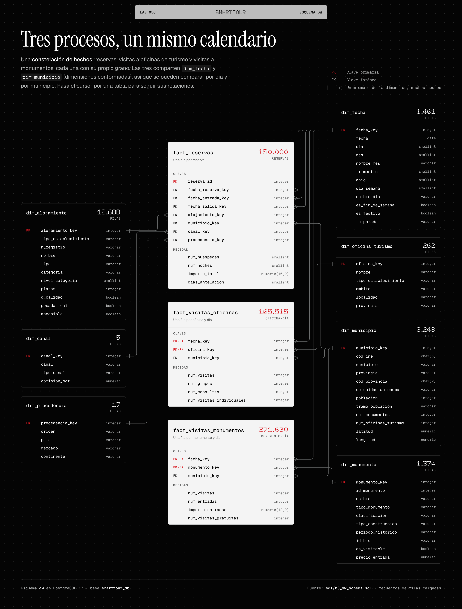
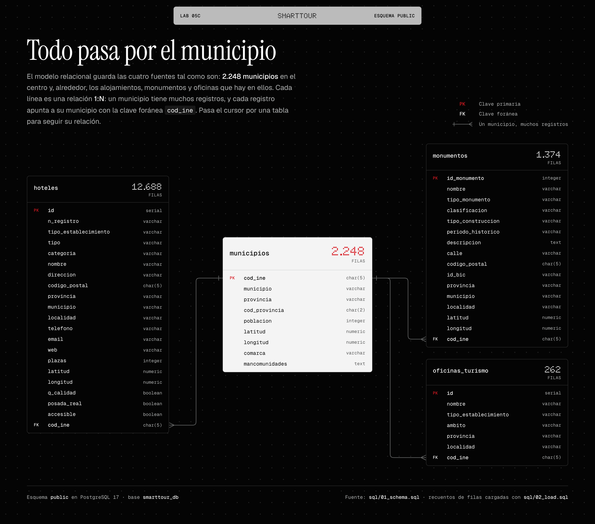
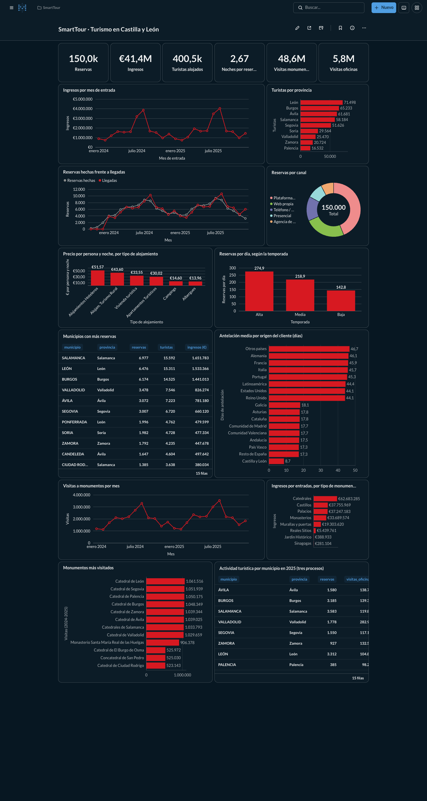

# Lab 05c · Construcción de la base de datos, vistas y SCD tipo 2

Base de datos relacional de SmartTour y Data Warehouse en **constelación de hechos**: reservas, visitas a oficinas de turismo y visitas a monumentos, que comparten `dim_fecha` y `dim_municipio`. Así se cubren las cinco dimensiones del enunciado (fecha, municipio, hotel, oficina y monumento) y sus diez consultas.

| Parte del enunciado | Dónde está |
|---|---|
| Pasos 1–12: Docker, PostgreSQL y pgAdmin | `docker-compose.yml` (ya existente desde el Lab 03) |
| Paso 13: modelo relacional `municipios` 1:N | `sql/01_schema.sql`, `sql/02_load.sql` (schema `public`) |
| Diagrama entidad-relación del modelo relacional | [`modelo_relacional.html`](modelo_relacional.html) · `modelo_relacional.png` |
| Constelación: 3 hechos y 7 dimensiones | `sql/03_dw_schema.sql` · diagrama [`constelacion.html`](constelacion.html) · `constelacion.png` |
| Hechos generados en CSV y cargados con `COPY` | `scripts/generate_dw.py` → `datasets/dw/*.csv`, `sql/04_dw_load.sql` |
| Vistas analíticas, vista con CTE y vista materializada | `sql/06_dw_views.sql` |
| SCD tipo 2 | `sql/07_dw_scd2.sql` |
| Tres fechas en la reserva (reserva, entrada y salida) | `fact_reservas` con tres claves hacia `dim_fecha` (`sql/03_dw_schema.sql`) |
| Cuadro de mando sobre las vistas (en lugar de Power BI) | Metabase en `docker-compose.yml` + `scripts/setup_metabase.py` |
| Explicación y comprobación de todo lo anterior | [`notebooks/03_Lab05c_Vistas_SCD.ipynb`](../../notebooks/03_Lab05c_Vistas_SCD.ipynb) |

## Constelación de hechos



| Tabla de hechos | Grano | Filas | Dimensiones |
|---|---|---|---|
| `fact_reservas` | Una reserva | 150.000 | fecha (reserva, entrada y salida), alojamiento, municipio, canal, procedencia |
| `fact_visitas_oficinas` | Una oficina en un día | 165.515 | fecha, oficina de turismo, municipio |
| `fact_visitas_monumentos` | Un monumento en un día | 271.630 | fecha, monumento, municipio |

Los tres hechos son simulados por `scripts/generate_dw.py` con semilla fija, a partir de atributos reales de las fuentes: tipo de monumento, ámbito de la oficina, población y patrimonio del municipio, y estacionalidad. Solo se simulan visitas en los monumentos con horario y taquilla (catedrales, monasterios, palacios, castillos, murallas, reales sitios, sinagogas y jardines históricos). Los demás quedan en `dim_monumento` con `es_visitable = false`.

Abre [`constelacion.html`](constelacion.html) en el navegador para ver la versión interactiva: al pasar el cursor por una dimensión se resaltan todos los hechos que la usan, y al pasar por un hecho, sus dimensiones.

## Modelo relacional



Abre [`modelo_relacional.html`](modelo_relacional.html) en el navegador para ver la versión interactiva: al pasar el cursor por una tabla se resalta su relación con `municipios`. Usa el mismo estilo que el diagrama de la estrella del Lab 05a.

## Reproducir

Con los contenedores levantados y desde la raíz del repositorio:

```bash
python scripts/generate_dw.py
for f in 01_schema 02_load 03_dw_schema 04_dw_load 06_dw_views 07_dw_scd2; do
  docker exec smarttour-postgres psql -v ON_ERROR_STOP=1 -U smarttour -d smarttour_db -f /smarttour/sql/$f.sql
done
```

`07_dw_scd2.sql` se puede volver a ejecutar sin repetir el cambio. Para volver al estado anterior al SCD2, ejecuta otra vez `03`, `04` y `06`.

## Vistas del schema `dw`

| Vista | Pregunta |
|---|---|
| `vw_reservas_municipio` | ¿Qué municipios reciben más reservas? |
| `vw_turistas_provincia` | ¿Qué provincias reciben más turistas alojados? |
| `vw_ingresos_mensuales` | ¿Cómo evolucionan los ingresos por mes? |
| `vw_estancia_alojamientos` | ¿Qué alojamientos reciben más turistas y cuánto duran sus estancias? |
| `vw_reservas_tipo_alojamiento` | ¿Qué tipo de alojamiento factura más y a qué precio por persona y noche? |
| `vw_reservas_canal` | ¿Qué canales se usan más y cuánto se paga en comisiones? |
| `vw_reservas_procedencia` | ¿De dónde vienen los clientes y con cuánta antelación reservan? |
| `vw_reservas_temporada` | ¿Cuántas reservas hay por día en cada temporada? |
| `vw_visitas_oficinas` | ¿Qué oficinas reciben más visitantes? (consulta 5) |
| `vw_visitas_oficinas_municipio` | ¿Qué municipios reciben más visitantes en sus oficinas? (consulta 6) |
| `vw_visitas_oficinas_mensuales` | ¿En qué meses hay más actividad en las oficinas? (consulta 7) |
| `vw_monumentos_mas_visitados` | ¿Cuáles son los monumentos más visitados? (consulta 8) |
| `vw_ingresos_monumentos` | ¿Qué monumentos generan más ingresos por entradas? (consulta 9) |
| `vw_visitas_monumentos_mensuales` | ¿Cómo evolucionan por mes las visitas a cada monumento? (consulta 10) |
| `vw_actividad_turistica_municipio` | Los tres procesos por municipio y año: cada hecho se agrega antes de unirlos (CTE) |
| `vw_calendario_reservas` | Reservas hechas, llegadas y salidas por mes: `dim_fecha` en sus tres papeles |
| `mv_reservas_municipio_mes` | Cubo municipio × mes precalculado (vista materializada) |


## Cuadro de mando con Metabase

El enunciado propone conectar las vistas a Power BI, pero Power BI Desktop solo existe para Windows. Se usa **Metabase**, que funciona en cualquier sistema como un contenedor más del laboratorio y lee directamente las vistas del schema `dw`.



Para levantarlo y montar el cuadro de mando:

```bash
docker compose up -d metabase
python scripts/setup_metabase.py
```

El script, que solo usa la librería estándar, hace por la API lo mismo que se haría a mano en Metabase:

1. Crea el usuario administrador.
2. Conecta `smarttour_db`.
3. Crea la colección **SmartTour** con 18 preguntas SQL sobre los tres procesos.
4. Monta el cuadro de mando **SmartTour · Turismo en Castilla y León**.

Se puede volver a ejecutar: archiva lo que creó antes y lo vuelve a crear.

| | |
|---|---|
| URL | http://127.0.0.1:3000 |
| Usuario | `alumno@clase.com` |
| Contraseña | `AdminClase2026!` |

Cada gráfico es una pregunta guardada en la colección SmartTour. Desde ahí se puede abrir, ver su SQL y modificarlo, o crear gráficos nuevos sobre cualquier vista `vw_*`.

